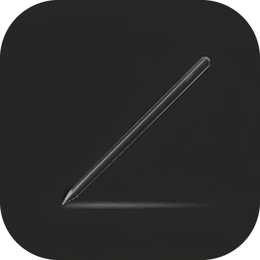
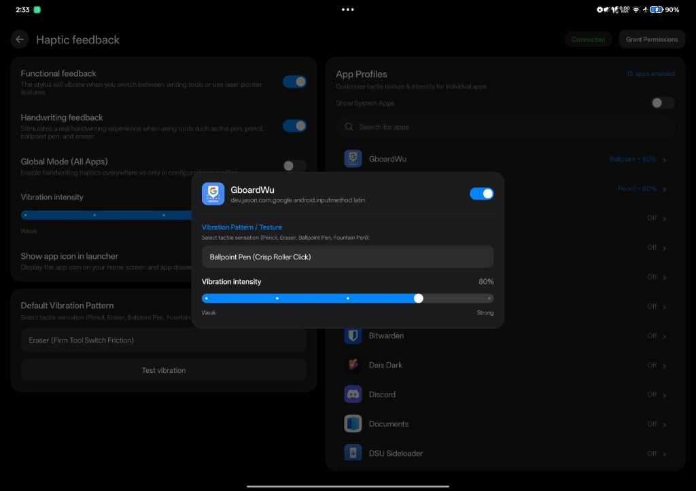

<div align="center">
  
  <h1>Advance stylo haptics</h1>
  <p><b>Advanced tactile and handwriting haptic engine for OnePlus Stylo 2 & OPPO Pencil 2 on ColorOS / OxygenOS 14+</b></p>
</div>

---

## Screenshots

<div align="center">
  
  &nbsp;
  
</div>

---

## Features

- **Native ColorOS / OxygenOS Design:** Built with ColorOS squircle containers, rounded popups, authentic toggle switches, flush intensity slider, and dark/light mode switching that dynamically adapts to system themes and floating window sizes.
- **Dual Launch Points:**
  - Standard launcher home screen icon (`Advance stylo haptics`).
  - Seamless system integration inside **Settings &rarr; System & update &rarr; Advance stylo haptics**.
- **Hardware-Level Tactile Textures:**
  - **Pencil:** Realistic graphite paper friction.
  - **Eraser:** Firm high-resistance rubber friction feel.
  - **Ballpoint:** Crisp, delicate mechanical roller tick.
  - **Fountain Pen:** Ultra-smooth fluid glide.
- **Global & Per-App Tactile Profiles:**
  - **Global Mode:** Universal stylus tactile feedback enabled across every drawing surface, browser, launcher, and floating window.
  - **Per-App Customization:** Customize distinct tactile patterns and vibration strength levels for specific drawing, sketching, note-taking apps, and floating keyboards (e.g. GboardWu).
- **In-App Vibration Test:** Test tactile waveforms and motor buzz directly in hand without switching apps.
- **Samsung OneUI S-Pen Air View & Air Command Suite:**
  - **Authentic Solid White Hover Pointer (Enabled by Default at 4dp):** Reverse-engineered OneUI solid white circular dot cursor with ambient drop shadow and high-contrast dark border matching official S-Pen visual styling when hovering ~1.5cm over screen glass. Instant fade-out upon glass contact so writing and drawing remain unobscured.
  - **Synchronized Compact Pointer Sizing (4dp &ndash; 16dp):** Customizable pointer size with live interactive visual preview beside the slider, scaling through 4dp, 6dp, 8dp, 12dp, and 16dp options.
  - **Zero-Lag Coalesced Hover Auto-Scroll:** Dispatches smooth synthetic touch swipes with native acceleration curves, avoiding jumpy page breaks and functioning across both full-screen layouts and floating/flexible windows. Atomic coalescing eliminates pointer freezing and lag when stopping scroll.
  - **Intelligent Context-Aware Hover Auto-Scroll Filtering:**
    - Background launcher detection completely disables hover scroll triggers while navigating the home screen or app drawer.
    - Protected system zones (top 48dp status bar and bottom 96dp taskbar/dock) prevent false scroll triggers while interacting with the tablet dock.
    - Asynchronous accessibility verification queries the view hierarchy to verify that the container directly under the stylus supports scrolling before displaying scroll arrows, eliminating false triggers over static cards.
    - 160ms dwell threshold prevents arrow flickering when swiftly moving across screen edges.
  - **5-Speed Smooth Scroll Control:** 5 configurable scroll pacing levels (Ultra Slow, Slow, Normal, Fast, Turbo) to support comfortable reading and rapid navigation.
  - **Rotary Arc Wheel Air Command Palette:**
    - Small 40dp translucent bubble (matching aircmd.jpg) with intelligent auto-hide when the stylus is docked, disconnected, or inactive for 4 seconds. Real-time hardware magnetic docking detection via sysfs (`/sys/devices/virtual/oplus_wireless/pencil/present` and `tx_status`) instantly hides the bubble when magnetically attached to the wireless charging rail. Smoothly fades back in upon pen hover or touch.
    - **Rotary Semicircular Arc Layout with Windowing:** Radial layout of tools with aperture windowing ($\pm 52^\circ$ active aperture, graceful fade between $52^\circ$ and $68^\circ$) preventing icon and pill overlap even when 10+ tools and custom apps are added. Includes drag-to-rotate interaction with tactile haptic tick feedback and anti-clipping edge calculations.
    - **Compact Typography & "Show Tool Labels" Preference:** Compact pill styling (11sp, 10dp H / 5dp V padding, 115dp max width, single-line truncation) with a dedicated dashboard toggle to hide text labels completely for a clean circular badge aesthetic.
    - **Fluid Opening & Closing Choreography:** Coordinated hub icon rotation (-135° to 0°), staggered decelerating item bloom, and synchronized scrim fade transitions.
    - **Native Tools Suite:**
      - **Laser pointer:** Interactive presentation laser pointer mode with glowing red cursor dot.
      - **Quick note:** Native ColorOS floating note card with drawing, handwriting, checklist, and audio recording tools.
      - **Capture:** Instant global screenshot trigger.
      - **Circle to Search:** Native Google Circle to Search trigger via system contextual search service call.
      - **Stylo Settings & App Shortcuts:** Direct settings launch and user-defined custom app shortcuts from any installed package. App shortcuts launch into ColorOS Zoom floating windows by default.
    - **Dark Card App Shortcut Picker:** Styled app selection modal matching the dark `#18181A` card theme with real-time app search.
- **Landscape View for Portrait Apps:**
  - Force portrait-only applications (such as OnePlus Games and learning apps) to render in landscape mode when the tablet is held horizontally using root-level Android compatibility overrides (`OVERRIDE_ANY_ORIENTATION`, `OVERRIDE_ANY_ORIENTATION_TO_USER`, `OVERRIDE_ENABLE_COMPAT_IGNORE_REQUESTED_ORIENTATION`).
  - Dedicated landscape management pane matching native tablet settings with live package search, system apps toggle, and persistent per-app switches.
- **Accessibility Persistence Engine & Root Watchdog:** Continuous background watchdog service automatically re-enables and binds StyloAccessibilityService upon force-stop or system reboot, guaranteeing zero permission loss under root.
- **Automated Root Detection & Direct Touchpanel Engine:** Automatically verifies root privileges and configures `/proc/touchpanel/pencil_control` and accessibility services on boot and launch without requiring manual user interaction or throwing raw binder exceptions.
- **KernelSU & Magisk Privileged Integration:** Deploys as a privileged system app with `com.oplus.permission.safe.IOT` to interface with ColorOS `IPeManager` (`ISdkAidlInterface`) and direct kernel touchpanel nodes.

---

## Requirements & Prerequisites

Before installing, ensure your environment meets the following requirements:

1. **Compatible Devices & Software:**
   - OnePlus Pad 2, OnePlus Pad Pro, OPPO Pad 2, OPPO Pad 3 Pro running ColorOS 14+ / OxygenOS 14+ (or compatible ColorOS 13+ builds).
   - Paired active stylus: **OnePlus Stylo 2** or **OPPO Pencil 2** (with internal BLE linear haptic motor).

2. **Root Solutions Supported:**
   - **KernelSU** (v0.9.0+)
   - **APatch** (v10763+)
   - **Magisk** (v26.0+)

3. **CRITICAL REQUIREMENT: OverlayFS for KernelSU & APatch (EROFS Partitions):**
   > [!IMPORTANT]
   > Modern ColorOS and OxygenOS (Android 14 / 15) mount `/system`, `/product`, and `/system_ext` partitions as read-only **EROFS**.
   >
   > KernelSU and APatch do **not** support traditional Magic Mount over EROFS without an active OverlayFS module. For the module to successfully inject `/system/priv-app/Stylo2Haptics/Stylo2Haptics.apk` and its privileged permission whitelist (`privapp-permissions-stylo2haptics.xml`), **OverlayFS support is strictly required**.
   >
   > **Required Actions for KernelSU / APatch Users:**
   > - Install and activate an OverlayFS module, such as **[KernelSU-OverlayFS](https://github.com/KernelSU/OverlayFS)** or **`meta-overlayfs`**, prior to flashing `StyloHapticsModule.zip`.
   > - Alternatively, if you do not have or cannot use OverlayFS, use **Method 3 (Standalone APK)** below with root setup or CorePatch / LuckyTool.

---

## Installation Guide

Choose the installation method suited for your device:

### Method 1: KernelSU / APatch / Magisk Module (Recommended)
This is the recommended method. It installs the application as a privileged system app (`priv-app`) with all required ColorOS stylus permissions pre-granted:
1. **Verify OverlayFS (KernelSU/APatch users):** Ensure you have an active OverlayFS module (e.g. `meta-overlayfs` or KernelSU-OverlayFS) installed. Magisk handles mounting automatically.
2. Download **`StyloHapticsModule.zip`** from [Releases](https://github.com/Subodhkr360/advance-stylo-haptics/releases).
3. Open **KernelSU**, **APatch**, or **Magisk** Manager on your tablet.
4. Go to **Modules** &rarr; **Install from storage** and select `StyloHapticsModule.zip`.
5. Reboot your device.
6. Launch **Advance stylo haptics** from your home screen or **Settings &rarr; System & update**.
7. When prompted, enable the **Advance stylo haptics Accessibility Service** (or tap **Automated Root Setup** to grant it instantly).

---

### Method 2: Custom ROM & Port Integration (For ROM Developers)
To bake Advance stylo haptics directly into a custom ROM or vendor image:
1. Place `Stylo2Haptics.apk` into `/system/priv-app/Stylo2Haptics/` (or `/my_product/priv-app/Stylo2Haptics/`).
2. Place `privapp-permissions-stylo2haptics.xml` into `/system/etc/permissions/` (or `/my_product/etc/permissions/`).
3. Set file permissions to `0644` (`rw-r--r--`).
4. *(Optional)* Pre-enable the accessibility service in your ROM's `SettingsProvider` defaults:
   ```xml
   <string name="def_enabled_accessibility_services">io.github.Subodhkr360.stylo2.haptics/io.github.Subodhkr360.stylo2.haptics.StyloAccessibilityService</string>
   <bool name="def_accessibility_enabled">true</bool>
   ```

---

### Method 3: Standalone APK (Rooted / CorePatch / LuckyTool)
If you prefer installing the APK directly without a module:
1. Download and install **`StyloHapticsStudio.apk`** from [Releases](https://github.com/Subodhkr360/advance-stylo-haptics/releases).
2. Because ColorOS protects the stylus AIDL with `com.oplus.permission.safe.IOT` (a signature/privileged permission):
   - You can use an Xposed module like **CorePatch** or **LuckyTool** to bypass signature permission restrictions for user apps.
   - Or grant root access when launching the app and tap **Automated Root Setup**.
3. Enable the **Advance stylo haptics Accessibility Service** under **Settings &rarr; Accessibility &rarr; Installed Apps**.

---

### Verification
1. Ensure your **OnePlus Stylo 2** or **OPPO Pencil 2** is connected via Bluetooth.
2. Tap **Test vibration** in the dashboard &mdash; the pen motor will buzz in your hand.
3. Open any drawing app (Notes, Sketchbook, HiPaint) or handwriting keyboard (GboardWu) and begin writing on the screen to feel the tactile paper sensation!

---

## Technical Architecture

1. **Bluetooth Low Energy (BLE) Stylus Motor Sync:**
   - Interacts with ColorOS `com.oplus.ipemanager` via AIDL (`ISdkAidlInterface` on `com.oplus.ipemanager.ACTION.PENCIL_SDK`).
   - Syncs physical vibration level and waveforms to stylus NVRAM config via `content://com.oplus.ipemanager.provider`.
2. **Touchpanel RF Micro-Vibration Coupling:**
   - Interfaces directly with `/proc/touchpanel/pencil_control` to coordinate screen touch events with pen motor resonance.
3. **Accessibility Foreground Tracker:**
   - Non-intrusive window focus and input-method watcher (`StyloAccessibilityService`) detecting top active applications and IMEs (including floating handwriting keyboards) within 250ms latency.

---

## Project Structure

```
StyloHapticsProject/
├── AndroidManifest.xml        # Manifest with launcher & settings injection
├── build.sh                  # One-click portable build & deployment script
├── debug.keystore            # Development signing keystore
├── docs/                     # App icon & high-resolution screenshots
│   ├── icon.png
│   ├── screenshot_main.jpg
│   └── screenshot_dialog.jpg
├── zipalign.py               # Pure Python 4-byte APK alignment utility
├── res/                      # ColorOS styled drawables, layouts, and colors
└── src/
    ├── com/oplus/ipemanager/
    │   ├── IUIPageCallback.java     # ColorOS Quick Note floating window callback
    │   └── sdk/
    │       ├── ISdkAidlInterface.java   # ColorOS Stylus AIDL interface
    │       ├── ISDKAidlCallback.java    # Stylus state change callback
    │       ├── Vibration.java           # Vibration waveform definitions
    │       └── IpeFeature.java          # Stylus hardware capability flags
    └── io/github/Subodhkr360/stylo2/haptics/
        ├── MainActivity.java            # ColorOS settings dashboard & tool manager
        ├── OnePlusSeekBar.java          # ColorOS flush thumb seekbar
        ├── StylusHapticsManager.java    # Stylus BLE & touchpanel driver
        ├── StyloAccessibilityService.java # App focus tracker & auto-scroll engine
        ├── AirViewManager.java          # OneUI Air View digitizer event engine
        ├── AirViewOverlayView.java      # Hardware overlay pointer & arrow renderer
        ├── AirCommandManager.java       # Air Command lifecycle & dock watchdog
        ├── AirCommandArcView.java       # Rotary radial arc wheel with aperture windowing
        ├── LandscapeViewManager.java    # Compatibility engine for portrait-only apps
        ├── LandscapeAppAdapter.java     # Per-app landscape orientation adapter
        ├── AppListAdapter.java          # Per-app tactile profile configuration
        └── BootReceiver.java            # Boot auto-initialization receiver
```

---

## Building from Source

### Prerequisites

- A Linux or Termux / Android Userspace environment with:
  - `aapt2`
  - `javac` (OpenJDK 17+)
  - `d8` (Android Dex compiler)
  - `apksigner`
  - `python3`
  - `android.jar` (API 34)

### Build Command

```bash
# Build standalone APK and Magisk/KernelSU flashable module:
./build.sh --no-install

# Build and automatically deploy directly on a rooted device:
./build.sh
```

- Standalone APK: `./StyloHapticsStudio.apk`
- Flashable Priv-App Module: `/storage/emulated/0/StyloHapticsModule.zip`

---

## Credits & Acknowledgements

- **Original Base Project:** [YeetingWaterbottle/stylo2-haptics](https://github.com/YeetingWaterbottle/stylo2-haptics) by **YeetingWaterbottle**. Sincere appreciation for the foundational research and initial discovery of OnePlus Stylo 2 haptic control interfaces.
- **Enhanced Edition:** Developed and refactored by **Subodhkr360** with Antigravity AI pair programming.

---

## License

This project is licensed under the Apache License 2.0 or GNU General Public License v3 (see original upstream repository for base licensing terms).
