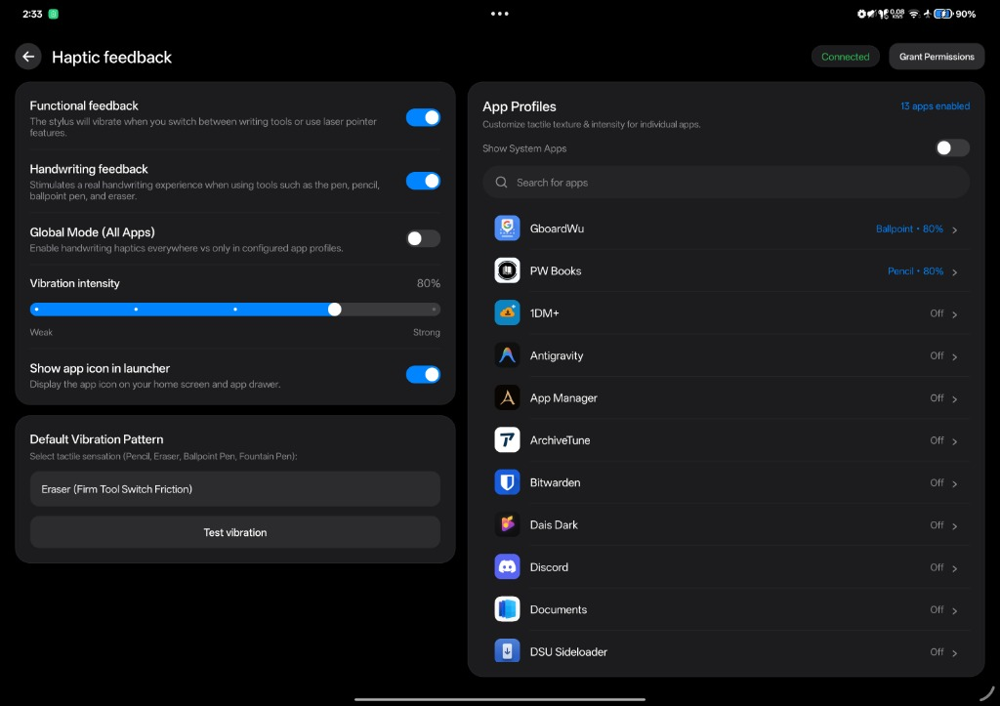

<div align="center">
  
  <h1>Advance stylo haptics</h1>
  <p><b>Advanced tactile and handwriting haptic engine for OnePlus Stylo 2 & OPPO Pencil 2 on ColorOS / OxygenOS 14+</b></p>
</div>

---

## Screenshots

<div align="center">
  
  &nbsp;
  
</div>

---

## Features

- **Native ColorOS / OxygenOS Design:** Built with ColorOS squircle containers, rounded popups, authentic toggle switches, flush intensity slider, and dark/light mode switching that dynamically adapts to system themes and floating window sizes.
- **Dual Launch Points:**
  - Standard launcher home screen icon (`Advance stylo haptics`).
  - Seamless system integration inside **Settings &rarr; System & update &rarr; Advance stylo haptics**.
- **Hardware-Level Tactile Textures:**
  - **Pencil:** Realistic graphite paper friction.
  - **Eraser:** Firm high-resistance rubber friction feel.
  - **Ballpoint:** Crisp, delicate mechanical roller tick.
  - **Fountain Pen:** Ultra-smooth fluid glide.
- **Global & Per-App Tactile Profiles:**
  - **Global Mode:** Universal stylus tactile feedback enabled across every drawing surface, browser, launcher, and floating window.
  - **Per-App Customization:** Customize distinct tactile patterns and vibration strength levels for specific drawing, sketching, note-taking apps, and floating keyboards (e.g. GboardWu).
- **In-App Vibration Test:** Test tactile waveforms and motor buzz directly in hand without switching apps.
- **KernelSU & Magisk Privileged Integration:** Automatically deploys as a privileged system app with `com.oplus.permission.safe.IOT` to interface directly with ColorOS `IPeManager` (`ISdkAidlInterface`) and hardware touchpanel nodes.

---

## Installation Guide

Choose the installation method suited for your device:

### Method 1: KernelSU / APatch / Magisk Module (Recommended)
This is the recommended method. It installs the application as a privileged system app (`priv-app`) with all required ColorOS stylus permissions pre-granted:
1. Download **`StyloHapticsModule.zip`** from [Releases](https://github.com/Subodhkr360/advance-stylo-haptics/releases).
2. Open **KernelSU**, **APatch**, or **Magisk** Manager on your tablet.
3. Go to **Modules** &rarr; **Install from storage** and select `StyloHapticsModule.zip`.
4. Reboot your device.
5. Launch **Advance stylo haptics** from your home screen or **Settings &rarr; System & update**.
6. When prompted, enable the **Advance stylo haptics Accessibility Service** (or tap **Automated Root Setup** to grant it instantly).

---

### Method 2: Custom ROM & Port Integration (For ROM Developers)
To bake Advance stylo haptics directly into a custom ROM or vendor image:
1. Place `Stylo2Haptics.apk` into `/system/priv-app/Stylo2Haptics/` (or `/my_product/priv-app/Stylo2Haptics/`).
2. Place `privapp-permissions-stylo2haptics.xml` into `/system/etc/permissions/` (or `/my_product/etc/permissions/`).
3. Set file permissions to `0644` (`rw-r--r--`).
4. *(Optional)* Pre-enable the accessibility service in your ROM's `SettingsProvider` defaults:
   ```xml
   <string name="def_enabled_accessibility_services">io.github.Subodhkr360.stylo2.haptics/io.github.Subodhkr360.stylo2.haptics.StyloAccessibilityService</string>
   <bool name="def_accessibility_enabled">true</bool>
   ```

---

### Method 3: Standalone APK (Rooted / CorePatch / LuckyTool)
If you prefer installing the APK directly without a module:
1. Download and install **`StyloHapticsStudio.apk`** from [Releases](https://github.com/Subodhkr360/advance-stylo-haptics/releases).
2. Because ColorOS protects the stylus AIDL with `com.oplus.permission.safe.IOT` (a signature/privileged permission):
   - You can use an Xposed module like **CorePatch** or **LuckyTool** to bypass signature permission restrictions for user apps.
   - Or grant root access when launching the app and tap **Automated Root Setup**.
3. Enable the **Advance stylo haptics Accessibility Service** under **Settings &rarr; Accessibility &rarr; Installed Apps**.

---

### Verification
1. Ensure your **OnePlus Stylo 2** or **OPPO Pencil 2** is connected via Bluetooth.
2. Tap **Test vibration** in the dashboard &mdash; the pen motor will buzz in your hand.
3. Open any drawing app (Notes, Sketchbook, HiPaint) or handwriting keyboard (GboardWu) and begin writing on the screen to feel the tactile paper sensation!

---

## Technical Architecture

1. **Bluetooth Low Energy (BLE) Stylus Motor Sync:**
   - Interacts with ColorOS `com.oplus.ipemanager` via AIDL (`ISdkAidlInterface` on `com.oplus.ipemanager.ACTION.PENCIL_SDK`).
   - Syncs physical vibration level and waveforms to stylus NVRAM config via `content://com.oplus.ipemanager.provider`.
2. **Touchpanel RF Micro-Vibration Coupling:**
   - Interfaces directly with `/proc/touchpanel/pencil_control` to coordinate screen touch events with pen motor resonance.
3. **Accessibility Foreground Tracker:**
   - Non-intrusive window focus and input-method watcher (`StyloAccessibilityService`) detecting top active applications and IMEs (including floating handwriting keyboards) within 250ms latency.

---

## Project Structure

```
StyloHapticsProject/
├── AndroidManifest.xml        # Manifest with launcher & settings injection
├── build.sh                  # One-click portable build & deployment script
├── debug.keystore            # Development signing keystore
├── docs/                     # App icon & high-resolution screenshots
│   ├── icon.png
│   ├── screenshot_main.jpg
│   └── screenshot_dialog.jpg
├── zipalign.py               # Pure Python 4-byte APK alignment utility
├── res/                      # ColorOS styled drawables, layouts, and colors
└── src/
    ├── com/oplus/ipemanager/sdk/
    │   ├── ISdkAidlInterface.java   # ColorOS Stylus AIDL interface
    │   ├── ISDKAidlCallback.java    # Stylus state change callback
    │   ├── Vibration.java           # Vibration waveform definitions
    │   └── IpeFeature.java          # Stylus hardware capability flags
    └── io/github/Subodhkr360/stylo2/haptics/
        ├── MainActivity.java            # ColorOS settings dashboard
        ├── OnePlusSeekBar.java          # ColorOS flush thumb seekbar
        ├── StylusHapticsManager.java    # Stylus BLE & touchpanel driver
        ├── StyloAccessibilityService.java # App & IME focus tracker
        ├── AppListAdapter.java          # Per-app profile configuration
        └── BootReceiver.java            # Boot auto-initialization receiver
```

---

## Building from Source

### Prerequisites

- A Linux or Termux / Android Userspace environment with:
  - `aapt2`
  - `javac` (OpenJDK 17+)
  - `d8` (Android Dex compiler)
  - `apksigner`
  - `python3`
  - `android.jar` (API 34)

### Build Command

```bash
# Build standalone APK and Magisk/KernelSU flashable module:
./build.sh --no-install

# Build and automatically deploy directly on a rooted device:
./build.sh
```

- Standalone APK: `./StyloHapticsStudio.apk`
- Flashable Priv-App Module: `/storage/emulated/0/StyloHapticsModule.zip`

---

## Credits & Acknowledgements

- **Original Base Project:** [YeetingWaterbottle/stylo2-haptics](https://github.com/YeetingWaterbottle/stylo2-haptics) by **YeetingWaterbottle**. Sincere appreciation for the foundational research and initial discovery of OnePlus Stylo 2 haptic control interfaces.
- **Enhanced Edition:** Developed and refactored by **Subodhkr360** with Antigravity AI pair programming.

---

## License

This project is licensed under the Apache License 2.0 or GNU General Public License v3 (see original upstream repository for base licensing terms).
